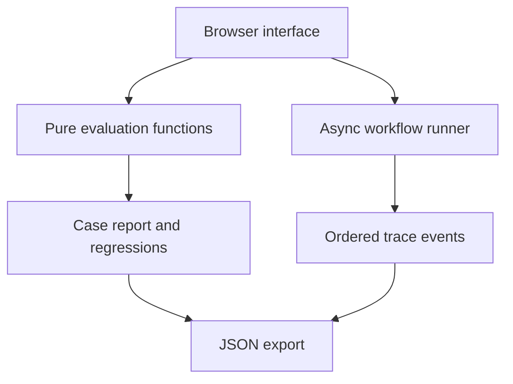

# AI Engineering Lab

Three independent portfolio engineering tools by **Neeli Yaswanth Kumar**, including a supervised AI coding agent and two browser-based evaluation/workflow demos.

- **RepoPilot** is a human-supervised Python issue-to-patch agent with restricted Docker verification, a reviewed draft-PR workflow, and a deployable read-only CLI container. [Stable release v2.2.0](https://github.com/kyaswanthneeli-stack/ai-engineering-lab/releases/tag/v2.2.0) · [Verified release evidence](repopilot/docs/RELEASE_EVIDENCE_v2.2.0.md) · [Live walkthrough](https://kyaswanthneeli-stack.github.io/ai-engineering-lab/repopilot/recruiter-demo.html). Its selected official SWE-bench Lite score is **1/12 resolved (8.3%)**; this is not a fully autonomous production service.
- **EvalBench** compares saved answer sets using transparent lexical metrics and required-phrase checks.
- **TraceFlow** exposes a simulated asynchronous tool workflow, including retries, call budgets, cancellation and missing evidence.

EvalBench and TraceFlow are browser-only portfolio demonstrations with synthetic data; neither demo calls an LLM. RepoPilot is a separate Python package that can call a configured model on a trusted operator host, with explicit human approval before draft PR publication. It is a tested supervised coding prototype, not an enterprise SaaS.

## Open the demos and RepoPilot release

[Engineering Lab](https://kyaswanthneeli-stack.github.io/ai-engineering-lab/) · [EvalBench](https://kyaswanthneeli-stack.github.io/ai-engineering-lab/evalbench.html) · [TraceFlow](https://kyaswanthneeli-stack.github.io/ai-engineering-lab/traceflow.html)

## Run locally

No installation or API keys required. Python 3 can serve the static files:

```bash
python3 -m http.server 8000
```

Open `http://localhost:8000`. Node.js 18+ runs the tests:

```bash
node --test tests/engine.test.js
```

## EvalBench walkthrough

1. Run the five saved answer comparisons.
2. Inspect the expected answer, baseline and candidate side by side.
3. Filter to regressions: cases that passed in the baseline and failed in the candidate.
4. Adjust the token F1 threshold and rerun.
5. Export the sample cases, edit the JSON and import your own set.
6. Export a report for inspection outside the application.

```json
[
  {
    "id": "refund-window",
    "question": "How long is the refund window?",
    "expected": "Submit within 30 days.",
    "answerA": "Submit within 30 days.",
    "answerB": "Submit within 60 days.",
    "required": ["30 days"]
  }
]
```

Case IDs must be unique; text fields are capped at 10,000 characters. Imports accept 1–100 cases, up to 200 KB. Data remains in browser memory and disappears on reload.

### Metrics and their limitations

Token F1 is `2 × overlapping tokens / (reference tokens + answer tokens)`, using token counts rather than just unique words. Normalization lowercases text, removes punctuation and collapses whitespace. Exact match compares normalized strings. Required phrases use normalized substring matching. A case passes when F1 meets the threshold and every required phrase is present.

This is a **lexical regression baseline**, not a factuality evaluator. Similar words can hide a wrong number or negation. Required phrases help catch known constraints, but they are not semantic or entailment checks. Correct paraphrases can score poorly. The fixed sample contains two deliberate regressions; it is not a model-quality benchmark.

## TraceFlow walkthrough

1. Run a successful lookup: classify → order lookup → shipment lookup → summary.
2. Select temporary timeout to inspect a failed first attempt and one retry.
3. Select missing order: the workflow stops without querying a shipment or inventing a status.
4. Lower the budget to two: no more than two attempted steps execute, and no final answer is produced.
5. Cancel a run while it is active.
6. Export the ordered trace as JSON.

### Execution semantics

`runWorkflow` accepts an AbortSignal, call budget, scenario, simulated delay and event callback. Each attempted step consumes one budget unit, including retries and summary composition. Order lookup permits at most two attempts. Cancellation interrupts simulated waits and stops later steps. Missing evidence returns a distinct `no_evidence` outcome.

The tools return hard-coded synthetic data. Classification is deterministic; the summary is a template. No model decides tool selection, no real SQL runs, and the displayed dates do not represent an actual shipment. Delays illustrate execution order and are not latency benchmarks.

## Architecture



| File | Responsibility |
| --- | --- |
| `engine.js` | Evaluation, validation, asynchronous runner and cancellation |
| `fixtures.js` | Fictional answer cases |
| `evalbench.js` | Comparison interface, filters and case import |
| `traceflow.js` | Scenario controls and event rendering |
| `shared.js` | Escaping and JSON downloads |
| `tests/engine.test.js` | Evaluation, validation, retry, budget and cancellation tests |

## Engineering choices

- Pure evaluation functions are separate from DOM rendering, so tests do not require a browser.
- Imported strings are escaped before rendering.
- No persistent storage or external scripts are used.
- Execution events include sequence numbers, attempts, outputs and failures.
- Failure, missing evidence and cancellation have distinct outcomes.
- Source code and fixtures stay small enough to inspect during an interview.

## Future work

EvalBench: dataset versioning, semantic evaluation with reviewed rubrics, human labels, a held-out dataset and aggregate uncertainty reporting.

TraceFlow: injectable real tool adapters, schema validation, persisted traces and idempotency. A real service would also need authentication, authorization, secrets management and operational monitoring.

[Portfolio](https://kyaswanthneeli-stack.github.io/) · [GitHub](https://github.com/kyaswanthneeli-stack)
