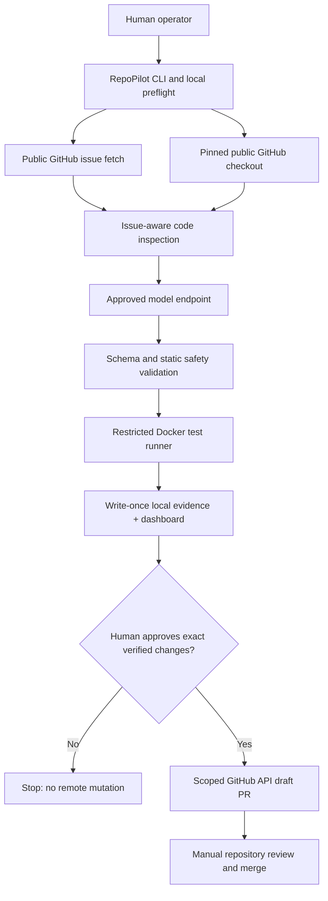

# RepoPilot architecture — 2.2.0rc1

RepoPilot is a **human-supervised Python CLI workflow**. It does not run as
a public web API or accept unattended internet traffic.

## Trust boundaries

| Boundary | Controls | Remaining risk |
|---|---|---|
| Public issue / upstream source | Pinned SHA, constrained URL/parser, bounded input; no untrusted instructions executed by host | Prompt injection / malicious repo source may influence model |
| Model output | Inspected-file path allowlist, JSON schema, patch application validation and static review | Valid-looking patches can still be semantically wrong |
| Candidate execution | Fixed unittest command; networkless, nonroot, read-only Docker; CPU/memory/PID/time limits | Host Docker is privileged and kernel isolation is not a strong sandbox against every exploit |
| Draft PR publication | Human approval token, exact proposal digest and verified evidence, remote identity and source equality | Incorrect human review or compromised write credentials |
| CI/release | Measured Python tests, real Docker integration, package build and offline image smoke; commit-scoped tags | Third-party base images/dependencies need periodic audit; no continuously monitored service |

## Operational deployment

* **Read-only CLI OCI image:** No GitHub token, no Docker socket, no
  model credentials, no listening port. Intended for `index`, `graph`,
  `--help` and offline evidence viewing. May be distributed through GHCR.
* **Repair worker:** Separate operator-owned host with Git, Docker and
  configured Ollama or an approved model endpoint. Handles public issue
  retrieval, patch generation and verification. Requires human approval
  before draft PR creation. No unattended scheduler or SaaS is installed.
* **Static portfolio pages:** GitHub Pages displays a fixed demonstration,
  not live model sessions or private reports.

## State and failure semantics

Every run writes a unique `.runs/` evidence directory on the trusted host.
A missing model prediction, timeout, dependency-incomplete baseline or
inconclusive smoke probe is **not** a solved issue. A `verified_in_sandbox`
label means only that a defined local reproduction sequence passed, not
that a historical SWE-bench issue was independently resolved. Exact official
v9 SWE-bench Lite result: **1/12 selected resolved**. Official evaluator
provenance and submitted/evaluated/selected denominators are reported
separately from model-generation success.

## Planned future extensions (not present)

A production hosted service would require authenticated API ingress,
per-user authorization, quotas, durable queues, distributed workers,
sandbox isolation beyond a shared Docker daemon, secrets management,
disaster recovery, security scanning, service observability and reliable
performance on a larger independent benchmark. Do not advertise these
as features of the current release candidate.

## Candidate quality and smoke diagnosis

The bounded benchmark agent checks every accepted finish schema (exact edits,
complete files or unified diff) in a private data-only overlay before submission.
It rejects an edit when ordinary string/bytes literal values, every other Python
token and token positions are equal across all affected files. This catches the
observed quote-only pytest proposal. Correction uses the existing model-step and
wall-clock budgets; repeated quote-only proposals fail without a submission.
Original source is never modified or imported by this static check.

This is a narrow repair heuristic, not a general proof of behavioral equivalence
or correctness. Changes to values, comments, directives, line positions or other
tokens are not rejected by it. Source reflection can depend on exact spelling;
an operator can set `REPOPILOT_REJECT_QUOTE_ONLY=0` for that use case. Unsupported
syntax, unsafe paths and unavailable analysis receive `unavailable`, not a pass.
Attempt records preserve `candidate_quality` independently of official scoring.

Smoke reports now include separate baseline, fallback-baseline and candidate
exit codes and fixed failure categories. Stdout is discarded; only the last
4 KiB of temporary stderr is inspected and the temporary file is discarded.
No traceback, exception message, missing module name or source path is retained
in reports or model feedback. Categories are observed hints from untrusted
stderr, not authenticated root-cause evidence, and do not turn a failure into a
pass. Docker launch/client failures, resource/signal exits, timeouts and uncertain
cleanup stay inconclusive. A normal failing Python probe after the same original
probe passes can still establish a limited regression signal.

Real restricted-Docker CI verifies an import-failing baseline yields sanitized
`import_error` evidence. These checks do not change the verified official
SWE-bench result of **1/12 selected tasks resolved**; another controlled experiment
and official harness run are required before claiming an accuracy improvement.

### Opt-in historical import setup

`REPOPILOT_CANDIDATE_SMOKE_BOOTSTRAP=1` enables a developer-owned import-only
profile inside the existing restricted Docker runner. It restores nine removed
`collections` aliases from `collections.abc` for historical SymPy checkouts, or
configures minimal in-memory Django settings and the contenttypes application
for Django import probes. It also supports conventional `src/` and `lib/`
source layouts when those directories are not Python packages themselves.
Generated import probes check that the imported file is the pinned source path,
rather than an installed package with the same name.

The setting defaults to **0**. Public issue snippets retain their own setup;
the profile is applied only to developer-generated imports and import fallbacks.
The exact same setup and probe run against original and candidate source. No
target setup scripts, migrations, dependency installation or native builds run
on the host. Reports distinguish baseline and fallback profiles and retain only
fixed categories for legacy API or known native-extension failures.

The four-case replay workflow verifies the historical v9 provenance and file
hashes, reuses the original proposals and exact pinned commits, and compares
setup off/on without any model calls. It does not execute the official evaluator
or produce a new resolution score. These are deliberately weak compatibility
checks; a passing import can still accompany an incorrect semantic patch.

### Frozen source behavior and pinned native support

`REPOPILOT_CANDIDATE_SOURCE_EXAMPLES=1` selects at most one complete original
docstring containing 1–8 runnable doctest examples and an expected output.
Selection is static and bounded to existing inspected source files, a 6,000
character docstring and 2,400 example/expectation characters. Skipped-only and
import-only examples are excluded. Target Python never executes on the host.

The exact original examples and their SHA-256 are frozen before the candidate
overlay is applied. Inside Docker, doctest runs them against the imported
original or candidate module, after source-origin verification. A candidate
cannot pass by rewriting its own docstring expectations. Only an original-pass,
candidate-fail comparison is a regression; a failing original example can fall
back to a transparently weaker import probe within the same time budget.

`REPOPILOT_CANDIDATE_MATPLOTLIB_NATIVE=1` selects one developer-owned, immutable
official SWE-bench instance-image digest for the supported Matplotlib base
`c33557d120eefe3148ebfcf2e758ff2357966000`. No model/issue-supplied image reference
is accepted. The runtime requires no tracked package/native-source differences
against that base and matching original target-file hashes. A provenance failure
is inconclusive, never a successful validation or candidate regression.

The package loader uses the read-only `/workspace` Python source and candidate
overlays first; matching native/built assets may come from the image's `/testbed`
checkout. Imported target-file origins remain checked. Execution keeps the
existing offline, nonroot, read-only, capability, PID, memory and CPU limits,
with only bounded temporary Matplotlib configuration writes. Both new features
default to off. Their replay workflow compares identical issue-text hashes,
source pins and preserved proposals, without a model or official evaluator.
