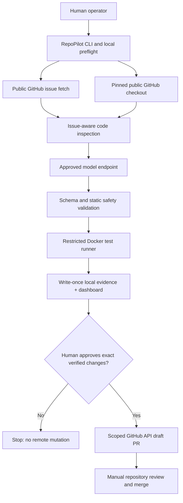

# RepoPilot architecture — 2.2.0rc1

RepoPilot is a **human-supervised Python CLI workflow**. It does not run as
a public web API or accept unattended internet traffic.

## Trust boundaries

| Boundary | Controls | Remaining risk |
|---|---|---|
| Public issue / upstream source | Pinned SHA, constrained URL/parser, bounded input; no untrusted instructions executed by host | Prompt injection / malicious repo source may influence model |
| Model output | Inspected-file path allowlist, JSON schema, patch application validation and static review | Valid-looking patches can still be semantically wrong |
| Candidate execution | Fixed unittest command; networkless, nonroot, read-only Docker; CPU/memory/PID/time limits | Host Docker is privileged and kernel isolation is not a strong sandbox against every exploit |
| Draft PR publication | Human approval token, exact proposal digest and verified evidence, remote identity and source equality | Incorrect human review or compromised write credentials |
| CI/release | Measured Python tests, real Docker integration, package build and offline image smoke; commit-scoped tags | Third-party base images/dependencies need periodic audit; no continuously monitored service |

## Operational deployment

* **Read-only CLI OCI image:** No GitHub token, no Docker socket, no
  model credentials, no listening port. Intended for `index`, `graph`,
  `--help` and offline evidence viewing. May be distributed through GHCR.
* **Repair worker:** Separate operator-owned host with Git, Docker and
  configured Ollama or an approved model endpoint. Handles public issue
  retrieval, patch generation and verification. Requires human approval
  before draft PR creation. No unattended scheduler or SaaS is installed.
* **Static portfolio pages:** GitHub Pages displays a fixed demonstration,
  not live model sessions or private reports.

## State and failure semantics

Every run writes a unique `.runs/` evidence directory on the trusted host.
A missing model prediction, timeout, dependency-incomplete baseline or
inconclusive smoke probe is **not** a solved issue. A `verified_in_sandbox`
label means only that a defined local reproduction sequence passed, not
that a historical SWE-bench issue was independently resolved. Exact official
v9 SWE-bench Lite result: **1/12 selected resolved**. Official evaluator
provenance and submitted/evaluated/selected denominators are reported
separately from model-generation success.

## Planned future extensions (not present)

A production hosted service would require authenticated API ingress,
per-user authorization, quotas, durable queues, distributed workers,
sandbox isolation beyond a shared Docker daemon, secrets management,
disaster recovery, security scanning, service observability and reliable
performance on a larger independent benchmark. Do not advertise these
as features of the current release candidate.
